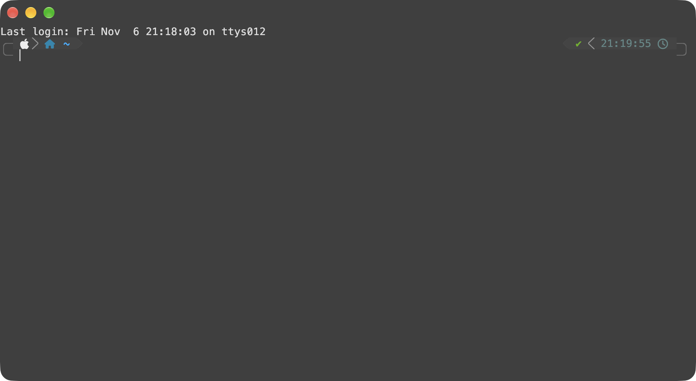

# kitty-configs

A compact, portable Kitty configuration for macOS with a minimal native title
bar, translucent background, inactive-pane dimming, a splits-first layout, and
simple Zsh helpers for creating panes. It also includes macOS-style text
editing shortcuts.



Tested with Kitty 0.50.0 and Zsh 5.9 on macOS.

## Contents

| Path | Purpose |
| --- | --- |
| `kitty.conf` | Kitty appearance, layout, shell integration, and keyboard shortcuts |
| `shaders/` | Custom brightness and saturation shaders for inactive panes |
| `kitty.app.icns` | Custom macOS application icon |
| `shell/kitty-splits.zsh` | One Kitty-only split helper with `sp`, `spr`, and `spl` aliases |
| `powerlevel10k/kitty-integration.zsh` | Optional Powerlevel10k/Kitty integration |
| `screenshot.png` | Preview of the resulting terminal |

## Requirements

- Kitty 0.50.0 or newer. The custom shader API used here is not available in
  older releases.
- Zsh for the pane-splitting aliases.
- macOS for the native title-bar options and the custom application icon. The
  terminal configuration can be adapted for Linux, but the title bar and icon
  sections are macOS-specific.

## Installation

### Before you start

1. Install Kitty, but do not open it yet. If Kitty is open, quit it with
   `Command+Q`. Closing the window is not enough.
2. Open the macOS Terminal app (`/Applications/Utilities/Terminal.app`).
   Run all commands in steps 1 to 5 in Terminal, in the same window.

Kitty reads remote control, socket, and Option key settings only when it
starts. If you install from inside a running Kitty, these settings do not take
effect, and the `sp`, `spr`, and `spl` helpers and Option characters such as `@`
and `#` do not work until you restart Kitty.

### 1. Clone the repository

In Terminal:

```sh
git clone https://github.com/esteban-mendoza/kitty-configs.git "$HOME/kitty-configs"
```

The commands below use the path `$HOME/kitty-configs`. If you clone the
repository to a different location, change the paths.

### 2. Back up your current Kitty configuration

In Terminal:

```sh
mkdir -p "$HOME/.config/kitty/backup"
cp -p "$HOME/.config/kitty/kitty.conf" "$HOME/.config/kitty/backup/" 2>/dev/null || true
cp -p "$HOME/.config/kitty/kitty.app.icns" "$HOME/.config/kitty/backup/" 2>/dev/null || true
```

If you already have a `shaders/` directory, back it up or merge it manually.

### 3. Install the configuration

In Terminal:

```sh
mkdir -p "$HOME/.config/kitty/shaders"
rm -f "$HOME/.config/kitty/kitty.conf"
ln -s "$HOME/kitty-configs/kitty.conf" "$HOME/.config/kitty/kitty.conf"
cp "$HOME/kitty-configs/shaders/dim-inactive-windows.pipeline" \
  "$HOME/kitty-configs/shaders/inactive-saturation.slang" \
  "$HOME/.config/kitty/shaders/"
cp "$HOME/kitty-configs/kitty.app.icns" "$HOME/.config/kitty/kitty.app.icns"
```

`kitty.conf` is a symlink, so changes that you pull into this repository take
effect without another copy step. Do step 2 first, because `rm -f` removes your
current `kitty.conf`.

Kitty automatically reads `kitty.app.icns` from its configuration directory on
macOS. It overrides the icon at startup; it does not replace the icon inside
`/Applications/kitty.app`.

### 4. Load the split helpers in Zsh

In Terminal, look for other `sp`, `spr`, or `spl` definitions, for example
aliases for another terminal's split command:

```sh
ZSH_DIR="${ZDOTDIR:-$HOME}"
grep -nE "(alias|function) +(sp|spr|spl)\b|^(sp|spr|spl) *\(\)" \
  "$HOME/.zshenv" "$ZSH_DIR/.zshenv" "$ZSH_DIR/.zprofile" "$ZSH_DIR/.zshrc" 2>/dev/null
```

Remove each line that the command finds. Other definitions that load after
the helpers replace them, and `sp`, `spr`, and `spl` then run a different
command.

Then add the helpers to the end of your `.zshrc`. The command adds the line
only if it is not already there:

```sh
grep -qF 'kitty-configs/shell/kitty-splits.zsh' "$ZSH_DIR/.zshrc" 2>/dev/null ||
  printf '\n# Kitty pane-splitting helpers (sp, spr, spl)\nsource "$HOME/kitty-configs/shell/kitty-splits.zsh"\n' >> "$ZSH_DIR/.zshrc"
```

Load the helpers only from `.zshrc`, not from `.zshenv` or `.zprofile`. Zsh
reads `.zshrc` for every interactive shell, which includes each new Kitty pane.
Keep the line at the end of `.zshrc`, after plugin managers and other files
that define aliases. If you set `ZDOTDIR`, your `.zshrc` is
`$ZDOTDIR/.zshrc`, not `~/.zshrc`.

The helpers use Kitty's remote control, which `kitty.conf` turns on:

```conf
allow_remote_control socket-only
listen_on unix:/tmp/kitty
```

### 5. Enable Powerlevel10k integration (optional)

If you use Powerlevel10k, open `~/.p10k.zsh` in an editor. Add this line
immediately after the line that starts with `unset -m`:

```zsh
source "$HOME/kitty-configs/powerlevel10k/kitty-integration.zsh"
```

This enables Powerlevel10k's Kitty shell integration only when `TERM` is
`xterm-kitty`, which prevents prompt redraw artifacts during resize.

### 6. Open Kitty and check the installation

1. Quit Terminal.
2. Open Kitty.
3. In Kitty, run:

   ```zsh
   type spl
   ```

   The output must be `spl is an alias for _kitty_split before`. If it is
   different, do step 4 again.
4. Run `spl`. A new pane opens on the left.
5. Type `Option+2` and `Option+3`. On Latin American and Spanish layouts, Kitty
   types `@` and `#`.

macOS caches Dock icons. If the old icon is still visible, run this in Kitty:

```sh
rm -f /var/folders/*/*/*/com.apple.dock.iconcache
killall Dock
```

### Apply later changes

After you edit `kitty.conf` or pull changes, reload the configuration from
inside Kitty with `Control+Command+,` or:

```sh
kitten @ load-config
```

Reloading does not apply `macos_option_as_alt`, `allow_remote_control`,
`listen_on`, window decorations, or the application icon. After you change one
of these, quit Kitty with `Command+Q` and open it again.

## Pane shortcuts

Source `shell/kitty-splits.zsh` as described above. It defines a single internal
function, `_kitty_split`, and three aliases:

| Command | Result |
| --- | --- |
| `sp` | Create a pane below the current pane |
| `spr` | Create a pane to the right of the current pane |
| `spl` | Create a pane to the left of the current pane |
| `sp htop` | Create a pane below and run `htop` in it |
| `spr npm run dev` | Create a pane to the right and run a command |
| `spl zsh` | Create a pane to the left and start a new shell |

Each helper uses the current Kitty window, preserves its working directory, and
focuses the new pane. The left split relies on this setting in `kitty.conf`:

```conf
enabled_layouts splits:split_axis=horizontal,...
```

## Keyboard shortcuts

| Shortcut | Action |
| --- | --- |
| `Option+Left` / `Option+Right` | Move backward or forward by one word |
| `Command+Left` / `Command+Right` | Move to the beginning or end of the line |
| `Option+Backspace` | Delete the previous word |
| `Option+Delete` | Delete the next word |
| `Command+Backspace` | Delete from the cursor to the beginning of the line |
| `Command+Z` / `Command+Shift+Z` | Undo / redo |
| `Command++` / `Command+-` | Increase / decrease font size |
| `Command+0` | Reset font size |
| `Command+Option+Left` / `Command+Option+Right` | Previous / next tab |
| `Command+Shift+Left` / `Command+Shift+Right` | Move the current tab left / right |
| `Control+Shift+Left` / `Control+Shift+Right` | Move focus to the pane on the left / right |
| `Control+Shift+Up` / `Control+Shift+Down` | Move focus to the pane above / below |

The text-editing shortcuts send the corresponding readline/Emacs control
sequences, so they work in Zsh and in applications that use readline-style key
bindings.

## Customization

The most useful settings in `kitty.conf` are:

```conf
font_size 13
background_opacity 0.75
initial_window_width 110c
initial_window_height 30c
```

The tab bar uses Kitty's `slant` style at the bottom:

```conf
tab_bar_style slant
tab_bar_edge bottom
tab_bar_min_tabs 2
```

Change `tab_bar_edge` to `top`, `left`, or `right` to move it. The included dark
tab palette can be adjusted with the `*_tab_background` and `*_tab_foreground`
settings in `kitty.conf`.

To change the inactive-pane appearance, edit
`shaders/dim-inactive-windows.pipeline`:

```conf
var float INACTIVE_DIM = 0.55
```

`INACTIVE_DIM` is the fraction of the original brightness retained. To change
saturation, edit `INACTIVE_SATURATION` in
`shaders/inactive-saturation.slang`.

To use a different square icon, replace `kitty.app.icns` with another `.icns`
file using the same name, then restart Kitty and clear the Dock cache if needed.

## Notes

- `macos_option_as_alt no` keeps Option's native macOS behavior, so characters
  that your keyboard layout types with Option still work. For example, Option+2
  types `@` and Option+3 types `#` on Latin American and Spanish layouts. The
  Option shortcuts in this config still work because Kitty always treats Option
  as Alt for its own mappings. Restart Kitty after you change this value.

  Trade-off: with `no`, programs that run in Kitty do not get Alt+key from
  Option. For example, Zsh `Alt+.` (insert last argument), Emacs `Meta` keys,
  and Alt keys in tmux or Vim do not work from Option. Pick the value that
  matches how you use the keyboard:

  | Value | Option types layout characters | Option sends Alt to programs |
  | --- | --- | --- |
  | `no` (default here) | Both Option keys | Neither |
  | `left` | Right Option only | Left Option only |
  | `right` | Left Option only | Right Option only |
  | `both` / `yes` | Neither | Both Option keys |

  `left` is a good compromise: use the right Option key for `@`, `#`, and
  other layout characters, and use the left Option key for Alt shortcuts.
- The `sp`, `spr`, and `spl` aliases replace any earlier aliases with the same
  names. If `spl` does not open a Kitty pane, run `type spl`. The output must
  be `spl is an alias for _kitty_split before`. If it is different, another
  definition loads after the helpers or `.zshrc` does not source
  `shell/kitty-splits.zsh`. Do step 4 of the installation again, then run
  `exec zsh`.
- `hide_window_decorations no` keeps the native macOS title bar so the window can
  be moved, minimized, zoomed, and closed.
- The configuration intentionally leaves the font family at Kitty's default.
  Add `font_family "Your Font"` to `kitty.conf` to use another monospaced font.
- The included icon is only applied on macOS. On other platforms, Kitty ignores
  `kitty.app.icns`.

## Credits

- `kitty.app.icns` is `tahoe/kitty-original.icns` from
  [sodapopcan/kitty-icon](https://github.com/sodapopcan/kitty-icon), copyright
  Andrew Haust, licensed under the MIT License. See
  `LICENSES/kitty-icon-MIT.txt`.
- `shaders/inactive-saturation.slang` is based on Kitty's
  `focus-highlight` shader, copyright Kovid Goyal, licensed under GPL-3.0. See
  `LICENSES/GPL-3.0.txt`.

## License

The configuration files and shell helpers are licensed under the MIT License.
See `LICENSE`. The shader files are licensed separately under GPL-3.0 as noted
above.
